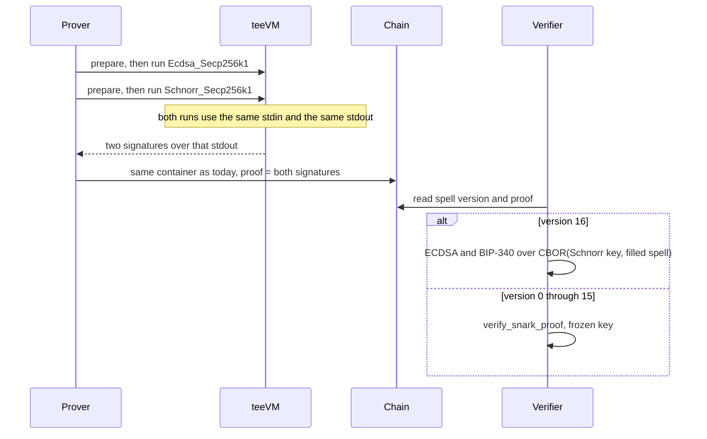

# teeVM Spell Certification - Plan

## Goal Capsule

- **Objective:** A version-16 spell is accepted when the pinned teeVM module signed its statement with both ECDSA and Schnorr, and a spell from version 15 or earlier still verifies under the SP1 key it verifies under today. A version-16 Bitcoin or Litecoin spell does not ask Scrolls to derive an address or sign a spend. A version-16 Cardano spell is not certified by a proof check inside `scrolls_cardano`.
- **Means:** One WASI program runs on teeVM. The version-16 proof is the ECDSA signature and the BIP-340 signature over that program's stdout. (KTD1, KTD2, KTD3, KTD7)
- **Authority:** The assignment's version gate, then the teeVM canister API as implemented in `teevm/teevm`, then this plan. `teevm/teevm.run` has no API.
- **Stop conditions:** Stop the guest work if a representative spell does not fit teeVM's current fuel, memory, stdout, and ingress caps and Ivan has not accepted a new teeVM build (Q4). Stop the mainnet pin and the Ethereum upgrade until Ivan answers the questions below. A published version-16 SP1 proof that must keep verifying changes the spell version (Q2).
- **Execution:** Code follows in later pull requests. This pull request is the plan. Ivan's assistant deploys the guest module, upgrades Scrolls canisters, and upgrades the Ethereum implementation. Those deploys are not part of implementation pull requests.
- **Who ships:** An implementer lands the code against the defaults here. Ivan's assistant runs the runbook and fills in the production key.

## Product Contract

### Summary

Version 16 spell proving moves from SP1 Groth16 to one WASI program that teeVM runs and signs. The version-16 proof is two signatures over that program's stdout: ECDSA secp256k1 and Schnorr BIP-340. Versions 0 through 15 keep today's Groth16 verification, and they keep today's Scrolls paths. A version-16 Bitcoin or Litecoin spell does not ask Scrolls for an address or a spend signature. A version-16 Cardano spell is certified by those teeVM signatures in the inline datum. `scrolls_cardano` does not verify that proof. Bitcoin, Litecoin, Cardano, and Ethereum keep their current containers for the spell and the proof.

### Problem Frame

Charms now proves a spell twice. `charms-spell-checker` checks the spell inside SP1 and commits the public values. `charms-proof-wrapper` verifies that compressed proof and commits the same bytes as a Groth16 proof that Bitcoin, Litecoin, Cardano, Ethereum, and the Scrolls canisters can check. teeVM signs the stdout of one WASI module with a key bound to that module. It does not produce a Groth16 proof, and it does not verify an inner proof. The wrapper step has nothing left to wrap.

Version 16 is the current protocol version (`CURRENT_VERSION` in `charms-client/src/lib.rs`). It is the version this guest already commits. The Ethereum proxy `0x7f7ab9224782dE7a20e89E6fc0DE52Ff6b48d8f0` is the mainnet host named by `ETHEREUM_FINALITY` and by `scrolls/BITCOIN-V16.md`. Whether any version-16 Groth16 proof under the current `SPELL_VK` has been published is Q2.

### Key Decisions

- Version 16 is the teeVM spell version. Governs R3. Versions 0 through 15 keep one frozen SP1 key each, as `docs/solutions/architecture-patterns/one-spell-version-one-verification-key.md` requires. The in-tree version-16 SP1 key is replaced because that note says a guest rebuild before release replaces the version-16 key, and it says the version was not released as of 2026-10-28. Q2 is the check that this is still true.
- Version 16 drops Bitcoin and Litecoin Scrolls address generation and spend-signing. Governs R8. The teeVM certificate on the spell is the authorization those canisters used to enforce before they would sign. Older versions keep `addresses` and `sign_and_submit`.
- Version 16 does not verify a spell proof inside `scrolls_cardano`. Governs R9. The teeVM certificate in the inline datum is the certification. The canister's Ed25519 co-sign stays, because it also satisfies the withdraw script and carries the input permutation. It is not removed. Mithril finality stays. There is no Cardano address-generation method to remove.

### Requirements

- R1. One program, compiled to a WASI preview 1 command module (`wasm32-wasip1`), is deployed to teeVM and replaces both `charms-spell-checker` and `charms-proof-wrapper` on the prove path.
- R2. That program reads the private spell input on stdin, checks the spell, and prints the version-16 public values on stdout.
- R3. A version-16 spell verifies under the pinned teeVM ECDSA key and the pinned teeVM Schnorr key, both over the same statement. A spell of version 0 through 15 verifies under today's SP1 Groth16 check and frozen key.
- R4. Bitcoin, Litecoin, Cardano, and Ethereum keep their current spell containers. For version 16, the proof bytes are the two teeVM signatures.
- R5. Each chain pins the module's Schnorr public key, its ECDSA public key, and its BLAKE3 hash. The 32-byte value inside the public values is the Schnorr key.
- R6. The prover, client, CLI, Scrolls canisters, Ethereum contracts, tests, and docs change as the units below say. teeVM canister deploys, Scrolls canister upgrades, and the Ethereum mainnet upgrade are a runbook for Ivan's assistant.
- R7. The design uses only behavior present in `teevm/teevm` and `teevm/teevm.run`. `teevm.run` contributes no API.
- R8. A version-16 Bitcoin or Litecoin spell does not call `addresses` and does not ask `sign_and_submit` to sign a spend of an output that spell created. Versions 0 through 15 keep that Scrolls path.
- R9. For a version-16 Cardano transaction, `scrolls_cardano` does not call `extract_and_verify_spell`. The client and the guest check the teeVM certificate in the inline datum. Versions 0 through 15 still verify the Groth16 proof inside `sign` and `certify_final`.

### Actors

- A1. A prover operator, who calls teeVM `prepare` and `run`.
- A2. A verifier: `charms-client`, a Scrolls canister, or `CharmsApply` on Ethereum.
- A3. Ivan's assistant, who deploys the module, upgrades canisters, and upgrades the Ethereum implementation.

### Key Flows

- F1. Prove a version-16 spell.
  - **Trigger:** `spell prove` or `POST /spells/prove` for a version-16 spell.
  - **Actors:** A1
  - **Steps:** Build `SpellProverInput`. Do not call `addresses` when the spell version is 16 and the chain is Bitcoin or Litecoin. Call teeVM `prepare` and `run` twice, once with `Ecdsa_Secp256k1` and once with `Schnorr_Secp256k1`, each with its own nonce. Both runs use the same plaintext and the same expected stdout. Embed the two signatures as the proof.
  - **Covered by:** R1, R2, R4, R8
- F2. Verify a spell pulled from a transaction.
  - **Trigger:** `extract_and_verify_spell`, a later spell's `is_correct`, or `CharmsApply.applySpell`.
  - **Actors:** A2
  - **Steps:** Read the spell version. Version 16 rebuilds the public values and checks both signatures. An older version uses `verify_snark_proof` unchanged.
  - **Covered by:** R3, R4
- F3. Spend a version-16 Bitcoin or Litecoin output.
  - **Trigger:** A wallet spends an output a version-16 spell created.
  - **Actors:** A1
  - **Steps:** The wallet signs the input with its own key and broadcasts. It does not call `sign_and_submit`. The next spell accepts the spent output when the creating transaction's teeVM certificate verifies.
  - **Covered by:** R8

### Acceptance Examples

- AE1. A version-16 Bitcoin spell verifies. Covers R3, R4.
  - **Given:** an `OP_RETURN` whose payload is CBOR of a version-16 spell, with `ins` and `coins` absent, and a 128-byte proof (ECDSA signature, then Schnorr signature).
  - **When:** verification copies the transaction's inputs and coin amounts back onto the spell.
  - **Then:** both signatures verify over CBOR of `(Schnorr key, filled spell)`, and the spell is returned.
- AE2. A version-15 spell still verifies. Covers R3.
  - **Given:** a transaction carrying a version-15 Groth16 proof under `V15_SPELL_VK`.
  - **When:** a version-16 verifier extracts it.
  - **Then:** `verify_snark_proof` accepts it, and neither version-16 teeVM key is consulted.
- AE3. An Ethereum native spell stays proof-free. Covers R4.
  - **Given:** a version-16 Ethereum spell that `native_spell` accepts, with an empty proof.
  - **When:** the client and `CharmsApply` see it.
  - **Then:** both accept it and neither checks a signature.
- AE4. A failed Bitcoin proof still hides the charms. Covers R3.
  - **Given:** a Bitcoin transaction whose version-16 ECDSA signature or Schnorr signature does not verify.
  - **When:** a later spell takes it as a previous transaction.
  - **Then:** `virtual_spell` yields an empty spell with that transaction's inputs and no outputs. An Ethereum failure still returns the extract error.
- AE5. A version-16 Bitcoin or Litecoin prove does not ask Scrolls for an address. Covers R8.
  - **Given:** a version-16 spell on Bitcoin or Litecoin, including one that lists `tx.scrolls`.
  - **When:** `spell prove` runs.
  - **Then:** it does not call `addresses`. A non-empty `tx.scrolls`, or a SCROLL-tagged output, fails the spell check. A version-15 spell on the same chain still calls `addresses` and still verifies `SignedScrollOutputs` under that chain's Scrolls Schnorr key.
- AE6. A version-16 Cardano spell is certified without a canister proof check. Covers R4, R9.
  - **Given:** a Cardano transaction whose inline datum is CBOR of a version-16 spell and the 128-byte teeVM certificate, and whose body still lists the Scrolls vkey and the withdraw-0 permutation.
  - **When:** the client extracts it, and when `scrolls_cardano.sign` is asked to co-sign it.
  - **Then:** the client accepts both teeVM signatures over the filled spell. `sign` adds the Ed25519 witness and does not call `extract_and_verify_spell`. A version-15 transaction on the same canister still fails `sign` when its Groth16 proof is bad.

### Success Criteria

- A reviewer can point at one WASI entry point, the two version-16 signature checks, and one unchanged Groth16 path for older versions.
- `cargo test` covers AE1 through AE6, and `forge test` covers the Ethereum signature checks and the native empty-proof path.
- No implementation pull request deploys a canister or an Ethereum contract.

### Scope Boundaries

In scope: the guest, the version gate, the two-signature certificate, skipping Bitcoin and Litecoin Scrolls address generation and spend-signing for version 16, skipping the Cardano canister's spell-proof check for version 16, the prover and CLI, the Ethereum verifier source, tests, and the doc updates in the units below.

Out of scope: a second teeVM canister, Falcon-1024, a new Plutus proof checker, changing versions 0 through 15, deleting Scrolls canisters, removing Cardano `sign`, `certify_final`, the withdraw-0 permutation, or `fee_address`, changing `scrolls_ethereum` or `charms_metadata`, and anything in `teevm/teevm.run` beyond recording that the repository has no API. Canister upgrades and the Ethereum mainnet upgrade stay in the runbook.

#### Deferred to Follow-Up Work

- Running the runbook: `deploy` of the guest wasm, writing both returned keys into the client and the new `CharmsApply`, upgrading `scrolls_cardano` so a version-16 `sign` does not verify the proof, and `upgradeToAndCall` on the Ethereum proxy.
- A teeVM build that raises fuel, stdout, or ingress, if Q4 says one is allowed and the guest does not fit.

### Assumptions

- The prover calls the teeVM canister already deployed as `tacke-5iaaa-aaaay-aae4q-cai` on subnet `re2t4-faa75-v3vhk-kdmdr-uyrkl-aik2l-ixd6u-p3fyr-zlfkc-6c5af-zae`. The ledger beside it is `thdmq-qqaaa-aaaay-aae4a-cai`.
- `run` is always given `public_input` equal to the hex of the stdout the guest must print. teeVM then rejects any other stdout with `PublicInputMismatch` and returns no signature.
- This repo has no Plutus script that checks a spell proof. The builder lists the Scrolls vkey as a required signer, and `sign` adds the matching witness only after `verify_tx`. Version 16 stops that proof check. It does not add a Plutus checker.
- Mock mode does not call teeVM. A mock proof must not verify under either pinned key when mock mode is off.
- The production Schnorr and ECDSA keys are unknown until `deploy` returns them. Tests use keys generated the way `teevm` `signing.rs` derives a test key. They do not embed a guessed mainnet key.
- A version-16 proof is 128 bytes: the 64-byte ECDSA signature, then the 64-byte BIP-340 signature. Both are over the same stdout. teeVM's `run` takes one algorithm, so the prover makes two calls. Q1 asks Ivan to confirm that, because the canister has no call that returns both.

### Open questions for Ivan

1. teeVM `run` returns one `signature` and the guest stdout. `teevm.did` on main (tree `8719e404df1b66de72976938e0f80080abdf6e35`) has no call that returns both algorithms. This plan treats the certificate as two `run` calls, ECDSA then Schnorr, and stores them as 128 bytes in that order. Is two calls, and that byte order, what you want?
2. Has any version-16 Groth16 proof under `SPELL_VK` `0x00764be83874ba96706a4134fc8c09ccc40f60a2988a6106f9a9134b1acfa4e9` been published on Bitcoin, Litecoin, Cardano, or Ethereum? `docs/solutions/architecture-patterns/one-spell-version-one-verification-key.md` says version 16 was not released as of 2026-10-28, and this plan replaces that key. `CHIPs/CHIP-0020/README.md` and `scrolls/BITCOIN-V16.md` name Ethereum proxy `0x7f7ab9224782dE7a20e89E6fc0DE52Ff6b48d8f0` as the current mainnet deployment. If a version-16 SP1 proof must keep verifying, the teeVM check has to be a new spell version. Which is it?
3. Ethereum `ecrecover` hashes with keccak256. teeVM `Ecdsa_Secp256k1` signs SHA-256 of the message and uses a 33-byte compressed key, so `ecrecover` cannot check it. The contract will check SHA-256 ECDSA and BIP-340 in Solidity, and `PROGRAM_VKEY` stays the 32-byte Schnorr key. Is that the Ethereum check you want?
4. One teeVM run allows 300,000,000 Wasmi fuel units, 64 MiB of memory, and 1 MiB of stdout. A `run` request must fit in a 2 MiB ingress message, and `public_input` is hex, so it is twice the statement. The certificate needs two runs of the same guest. If the WASI guest cannot re-check an older Groth16 proof and run app contracts inside those caps, only a new teeVM build can raise them. Is a new teeVM build available, or must the guest fit the current caps?
5. The `teevm/teevm.run` repository on main contains only the line "teeVM website (teevm.run)". This plan does not use it. Is a deployment or certificate flow planned there that is not in the repository yet?
6. `run` is a paid call, and the certificate is two of them. Anonymous callers are refused, and a balance at or below zero does not start the call. Which principal pays for Charms proving, and where do its credits come from?
7. teeVM controllers can upgrade the canister, and a signature attests that canister's code. Who may control `tacke-5iaaa-aaaay-aae4q-cai` for Charms, and is that trust accepted for version 16?
8. teeVM signs the spell statement. It does not sign a Bitcoin or Litecoin sighash, so the certificate is not a P2WPKH witness. This plan has the user's own key spend a version-16 output, and leaves `sign_and_submit` for outputs an older spell locked to a Scrolls key. Is that the split you want?
9. `sign_and_submit` rejects a spend whose fee output is below the canister's `check_fee`. A version-16 transaction never reaches that check. The prove builder can still add a fee output, and a hand-built transaction can leave it out. Where is the version-16 Charms fee enforced?
10. A version-16 spell that spends a pre-v16 Scrolls UTXO still needs the old canister to sign that input, including Bitcoin's `v14_sign_inputs` delegation to `lmbwh-3qaaa-aaaak-qunha-cai`. Does that path stay?
11. `scrolls_cardano` has no `addresses` method. `sign` on `tty7k-waaaa-aaaak-qvngq-cai` still co-signs, because `from_spell` lists `SCROLLS_VKEY_HASH` and a withdraw-0 whose script only checks that key, and because `extract_input_permutation` reads the input order from that redeemer. This plan removes the proof check inside `sign` and leaves the co-sign. Should version 16 also drop the required signer, the withdraw-0, and the call to `sign`? If yes, where does the input permutation go?
12. `verify_tx` also requires a fee output at `spell.tx.outs.len()` paid to `config.fee_address`. That check is not the spell proof. If version 16 still calls `sign`, the fee check stays. If Q11 drops `sign`, where is the Cardano fee enforced?
13. `certify_final` verifies the spell, then checks Mithril, then signs the tx-body hash under the `FINALITY` path. The client checks that signature in `proven_final` and does not call the canister. This plan skips only the spell check for version 16 and keeps the Mithril signature. Is that the finality path you want?

The code defaults stand until Ivan overrides them. The mainnet pin, the canister upgrades, and the Ethereum upgrade wait for his answers. Q2 changes the spell version if a published version-16 SP1 proof must survive. Q4 stops the guest if it does not fit and no new teeVM build is allowed. Q8 and Q10 change which spends still call a Scrolls canister. Q9 and Q12 change fee enforcement. Q11 changes whether a version-16 Cardano transaction still needs `sign`.

### Sources

- teeVM API and trust: `teevm/teevm` `README.md`, `DESIGN.md`, `src/teevm/teevm.did`, `src/teevm/src/lib.rs` (`run` signs `committed`), `src/teevm/src/signing.rs`, `src/teevm/src/guest/mod.rs` (`GUEST_FUEL`, `STDOUT_LIMIT`, `GUEST_MEMORY_LIMIT`). Main tree `8719e404df1b66de72976938e0f80080abdf6e35`.
- teeVM website repo: `teevm/teevm.run` `README.md` is the single file on main.
- Checker and wrapper: `charms-spell-checker/src/lib.rs`, `charms-proof-wrapper/src/lib.rs`.
- Version gate and public values: `charms-client/src/tx.rs` (`spell_vk`, `to_serialized_pv`, `verify_snark_proof`), `charms-client/src/lib.rs` (`CURRENT_VERSION`, `SpellProverInput`, `is_correct`).
- Embedding: `src/tx/bitcoin_tx.rs`, `charms-client/src/bitcoin_tx.rs`, `charms-client/src/litecoin_tx.rs`, `src/tx/cardano_tx/mod.rs`, `charms-client/src/cardano_tx.rs`, `charms-client/src/ethereum_tx.rs` (`ENVELOPE_PREFIX` is `CHET`).
- Scrolls: `src/tx/scrolls_bitcoin.rs`, `src/spell/prove_spell_tx.rs`, `scrolls/src/scrolls_bitcoin/src/lib.rs`, `scrolls/src/scrolls_litecoin/src/lib.rs`, `scrolls/src/scrolls-api/src/lib.rs`, `scrolls/src/scrolls_cardano/src/lib.rs`, `scrolls/src/scrolls_cardano/scrolls_cardano.did`.
- Ethereum check: `ethereum/src/CharmsApply.sol`, `ethereum/src/libraries/SpellCodec.sol`.
- One key per version, and host Ethereum decode stays out of the guest: `docs/solutions/architecture-patterns/one-spell-version-one-verification-key.md`, `docs/solutions/architecture-patterns/ethereum-host-spell-stays-out-of-the-guest.md`.
- Protocol spec for the current Groth16 layout: `CHIPs/CHIP-0020/README.md`.

## Planning Contract

### Key Technical Decisions

- KTD1. The prove path has one guest. `charms-proof-wrapper` verifies the checker's compressed SP1 proof and commits the same bytes (`charms-proof-wrapper/src/lib.rs`). teeVM has no inner-proof API. The WASI program is the checker, and the wrapper leaves the prove path. Governs R1.
- KTD2. Version 16 verification checks both teeVM signatures over the stdout bytes. Versions 0 through 15 stay on `verify_snark_proof`, including their vk-root and gnark layout. `spell_vk` for `CURRENT_VERSION` already returns the caller-supplied key. That 32-byte key is the Schnorr public key. Governs R3.
- KTD3. The certificate is both algorithms, because that is the constraint for version 16. teeVM `run` takes one algorithm, so the prover calls it twice on the same stdout. The proof is 128 bytes: the 64-byte SHA-256 ECDSA signature, then the 64-byte BIP-340 signature. The committed `[u8; 32]` and `PROGRAM_VKEY` stay the Schnorr key. The 33-byte compressed ECDSA key is a second pin. Ethereum checks SHA-256 ECDSA in Solidity. `ecrecover` hashes with keccak256, so it cannot check this signature. Ed25519 and Falcon-1024 are not part of the certificate. Governs R4, R5. Q1 and Q3 can change the byte order or the Ethereum check.
- KTD4. The signed bytes stay `to_serialized_pv` for version 15 and later: CBOR of `([u8; 32], NormalizedSpell)` with inputs and coins filled. Bitcoin, Litecoin, and Cardano still clear `ins` and `coins` before embedding (`src/spell/prove.rs` `clear_inputs_and_coins`) and copy them back before the check. Ethereum still stores the full spell, including inputs, in `EthereumTx.spell`. Governs R2, R4.
- KTD5. What is pinned is the Schnorr public key and the ECDSA public key from `deploy`, plus the module VK, which is BLAKE3 of the wasm bytes. `RunResponse` has `signature` and `committed` only. Verifiers recompute `committed` and check both signatures. The module hash tells operators which wasm the keys belong to. It is not a substitute for the signature check. Governs R5.
- KTD6. The Ethereum proxy address stays `0x7f7ab9224782dE7a20e89E6fc0DE52Ff6b48d8f0`. `PROGRAM_VKEY` and `VERIFIER` are immutable on `CharmsApply`, so both checks are a new implementation and `upgradeToAndCall` on that proxy. A new proxy would change `ETHEREUM_FINALITY.charms` and force another guest build (`one-spell-version-one-verification-key.md`). Native and placeholder spells keep an empty proof. Governs R4, R6.
- KTD7. Version 16 on Bitcoin and Litecoin does not create or spend a Scrolls address. The teeVM certificate replaces that trust. It is not a P2WPKH witness. Governs R8. The concrete paths are below.
- KTD8. Version 16 on Cardano does not verify the spell proof inside `scrolls_cardano`. The same certificate, in the existing inline datum, is what the client and the guest check. The co-sign stays. Governs R9. The concrete paths are below.

### High-Level Technical Design

The guest's `_start` reads CBOR `SpellProverInput` from stdin and calls `is_correct`. On success it writes `to_serialized_pv(16, schnorr_key, spell)` to stdout and exits 0. Any failed check is a non-zero exit. teeVM then returns `GuestFailed` and does not sign.

`is_correct` still runs app contracts through `AppRunner` (`charms-client/src/lib.rs`). That runner uses wasmi, so app wasm runs inside the guest, which itself runs inside teeVM's wasmi. The host allows one instance. The nested runner is ordinary guest code, so that limit does not block it. The fuel cost is Q4.

Previous transactions of version 16 are checked with both signature functions. Previous transactions of version 0 through 15 are checked with the existing Groth16 code, compiled into the WASI module. A version-15 checker cannot check a version-16 certificate. Spending a version-16 output requires a version-16 spell.

### Bitcoin and Litecoin Scrolls at v16

What the canisters do today, and what version 16 stops calling. The canisters stay deployed. Versions 0 through 15 keep these calls.

Address generation, used while proving:

- `src/spell/prove_spell_tx.rs` calls `src/tx/scrolls_bitcoin.rs` `fill_scroll_outputs`.
- Bitcoin calls `addresses` on `rpgc6-oqaaa-aaaak-qy3uq-cai`. Litecoin calls `addresses` on `ya3wx-vqaaa-aaaak-qzmja-cai`.
- The result is a scriptPubKey map and a Schnorr signature over it. The prover writes the scripts into `tx.coins[i].dest`.
- The guest checks that signature under `SCROLLS_ADDRS_PUBKEY` or `SCROLLS_LITECOIN_ADDRS_PUBKEY` in `charms-client/src/bitcoin_tx.rs`.
- `spell check` does not call the canister. A version-16 spell with a non-empty `tx.scrolls`, or a SCROLL-tagged output, fails the check instead of waiting for a script map.

Spend-signing, used when a Scrolls-controlled output is spent:

- `scrolls_bitcoin.sign_and_submit` and `scrolls_litecoin.sign_and_submit` verify the spell, check the fee, then `sign_with_ecdsa` on the P2WPKH sighash and broadcast.
- Bitcoin also delegates `v14_sign_inputs` to `lmbwh-3qaaa-aaaak-qunha-cai`.
- The charms CLI has no `sign_and_submit` command. The HTTP path is `scrolls/src/scrolls-api` `sign`, which calls `sign_and_submit` on the Bitcoin canister. That handler also calls a canister method `address`. The current `scrolls_bitcoin.did` exposes `addresses`, not `address`.

Version 16 does not call `addresses` or `sign_and_submit` for an output that spell created. The user's own key spends that output. The next spell accepts it when the creating transaction's teeVM certificate verifies. Those signatures are over the spell statement. They are not a Bitcoin or Litecoin witness. Q8 and Q10 cover spends of outputs an older spell already locked to a canister key. Q9 covers the fee check that `sign_and_submit` performs today.

`scrolls_ethereum` and `charms_metadata` are not this path. They stay.

### Cardano Scrolls at v16

`scrolls_cardano` (`tty7k-waaaa-aaaak-qvngq-cai`) does not generate addresses. Its service is `sign`, `certify_final`, `vkey`, `finality_vkey`, `config`, and the cycle helpers. `config.fee_address` is a configured address. This plan does not remove it.

Proof verification that goes away for version 16:

- `sign` and `certify_final` both call `verify_tx`.
- `verify_tx` calls `extract_and_verify_spell` (`scrolls/src/scrolls_cardano/src/lib.rs`), unless the transaction is the CIP-68 reference-NFT mint bypass. That bypass never checks a spell. It stays.
- For a version-16 transaction the canister parses what it needs and does not verify the proof. A version-15 or earlier transaction still takes the current Groth16 check.

What the transaction uses instead:

- The same Plutus inline datum: CBOR of `(NormalizedSpell, Proof)`.
- `Proof` is the 128-byte teeVM certificate.
- `CardanoTx::extract_and_verify_spell` in `charms-client` checks that certificate after it restores inputs from the withdraw-0 permutation. The guest does the same for a previous Cardano spell. Neither asks the canister whether the proof was valid.
- This repo has no Plutus script that checks a spell proof. No new one is added.

Co-signing that does not go away:

- `src/tx/cardano_tx/mod.rs` `from_spell` adds `SCROLLS_VKEY_HASH` as a required signer and a withdraw-0 from `SCROLLS_WITHDRAW_SCRIPT_HASH`. The comment on that withdrawal says the validator only checks that the vkey is in the required signers. The redeemer bytes are the input permutation.
- `make_transactions` calls `sign`. `sign` signs the tx-body hash with the canister's Ed25519 key and appends the witness.
- That witness is how the current script accepts the transaction. The permutation is how the client recovers input order before it can check the teeVM certificate. Neither exists only as the proof check, so version 16 still calls `sign` and still builds the withdrawal. Q11 is the question of dropping them anyway.
- `verify_tx` also checks the fee output. That check stays while `sign` stays. Q12 applies only if Q11 drops `sign`.

Finality that stays:

- `certify_final` checks Mithril, then signs the tx-body hash on the `FINALITY` derivation path.
- The client stores that as `CardanoTx::WithFinalityProof` and checks it with `FINALITY_VKEY` in `proven_final`. The charms CLI in this repo does not call `certify_final`.
- Version 16 skips the spell check in front of the Mithril check. The finality signature stays. Q13 asks to confirm that split.
- `vkey` and `finality_vkey` stay. Older transactions and the finality verifier read them.

The current canister rejects a teeVM proof inside `extract_and_verify_spell`. A version-16 `sign` or `certify_final` works only after the runbook upgrades `scrolls_cardano` so those methods skip the proof check for version 16. The implementation pull request changes the canister source. It does not upgrade the deployed canister.

teeVM's WASI host provides stdin, stdout, arguments, clocks frozen at 0, and `random_get`. It accepts only `wasi_snapshot_preview1` imports, plus exports `_start` and `memory`. The guest must not import anything else. Ethereum raw-transaction decode stays in `src/ethereum_raw.rs` (`ethereum-host-spell-stays-out-of-the-guest.md`). The app runner keeps its own shim for app contracts and does not forward `clock_time_get` to teeVM.

### Risks and Dependencies

- The guest links `charms-client`, which links Bitcoin, Cardano, the Groth16 verifier, and `charms-app-runner`. teeVM rejects a module with a non-WASI import. `getrandom` and similar crates have to resolve to WASI or to pure Rust. This is the main porting risk for U1.
- Fuel, memory, stdout, and the 2 MiB ingress cap are constants of the current teeVM build (`guest/mod.rs`, `DESIGN.md`). A spell whose public values approach Ethereum's 96 KiB `MAX_PUBLIC_VALUES` becomes about 192 KiB of hex before the ciphertext is added. U1 measures a representative spell, including one that verifies an older Groth16 previous transaction, and stops if it does not fit.
- A signature attests the canister code. Controllers who can upgrade teeVM can change what a signature means. Q7 records that trust. It is not a mathematical proof, which `DESIGN.md` states.
- `scrolls_bitcoin`, `scrolls_litecoin`, `scrolls_cardano`, and `charms_metadata` call `extract_and_verify_spell`. Until the runbook upgrades them, a canister still running the old wasm rejects a version-16 certificate. Version 16 Bitcoin and Litecoin proving does not need `addresses` or `sign_and_submit` for a new output. Version 16 Cardano proving still calls `sign` for the witness, so that upgrade has to land before a version-16 Cardano spell can be co-signed. `scrolls_ethereum` certifies beacon finality. It does not verify spell proofs.
- Dropping `sign_and_submit` on Bitcoin and Litecoin also drops that canister's fee check for a version-16 transaction. Q9. The Cardano fee check stays with `sign` unless Q11 says otherwise.
- `CharmsApply` on the named proxy still calls `ISP1Verifier.verifyProof` until the runbook upgrades the implementation. Off-chain verifiers and the contract disagree during that window.

### Alternatives considered

- Keep the wrapper as a second teeVM module that signs the checker's signature. teeVM binds keys per module and signs stdout only. Two modules would be two signatures and two pins, and the outer module would not be verifying an SP1 proof. KTD1 drops the wrapper.
- Put Groth16 and the teeVM certificate both on version 16. The version-16 key note says one version verifies under one statement key, and a second key made charms stay visible after a guest move. KTD2 keeps the Schnorr key as that statement key and checks both signatures against it. It does not also accept the old Groth16 key.
- Use only the Schnorr signature as the certificate. That was the earlier recommendation, because the committed statement has one 32-byte identity and `ecrecover` cannot check teeVM's ECDSA. Ivan required both signatures. KTD3 follows that. The ECDSA key is pinned beside the Schnorr key.
- Drop Cardano `sign` and the withdraw-0 because the script only checks the Scrolls vkey. The vkey requirement is the chain's stand-in for the canister proof check, but the same redeemer carries the input permutation the client needs before it can check the teeVM certificate. KTD8 leaves the co-sign in place. Q11 is the override.

Bake-off was skipped. The algorithm, the signed bytes, and the single module are specified by `signing.rs`, `to_serialized_pv`, and the teeVM `run` method. Comparing them needed that evidence, not a prototype.

## Implementation Units

### U1. WASI spell guest

- **Goal:** `charms-spell-checker` becomes the single WASI program teeVM can deploy, and the prove path no longer builds `charms-proof-wrapper`.
- **Requirements:** R1, R2
- **Dependencies:** none
- **Files:** `charms-spell-checker/src/lib.rs`, `charms-spell-checker/Cargo.toml`, `charms-spell-checker/Dockerfile`, `charms-spell-checker/check-guests.sh`, `.github/workflows/guests.yml`, `charms-proof-wrapper/`
- **Approach:**
  - Replace `sp1_zkvm::io::read_vec` and `commit_slice` with stdin and stdout. The CBOR types stay `SpellProverInput` and `([u8; 32], NormalizedSpell)`.
  - `self_spell_vk` is the Schnorr public key the guest also prints.
  - Target `wasm32-wasip1`. The module must pass teeVM `validate`: WASI preview 1 imports only, `_start` with empty params and results, exported `memory`.
  - Leave `src/ethereum_raw.rs` in the root crate.
  - Stop compiling the wrapper into the prove path. Keep the crate only if an older test still builds the ELF. Prefer deleting it once those tests are gone.
  - Do not call mainnet `deploy` from this unit.
- **Patterns to follow:** `charms-spell-checker/src/lib.rs` `run`, and teeVM `guests/sha256-preimage` for the WASI shape (stdin in, stdout out).
- **Test scenarios:**
  - Happy path: a known-good `SpellProverInput` on stdin exits 0 and stdout equals `to_serialized_pv` for version 16.
  - Edge: stdout for a spell at the large end of current fixtures stays under 1 MiB, and hex of that stdout plus the ciphertext is noted against the 2 MiB ingress cap.
  - Error: `is_correct` returning false exits non-zero and writes nothing that a caller could treat as a signature.
  - Integration: the wasm imports are only `wasi_snapshot_preview1`, and a local wasmi run with clocks forced to 0 still accepts a spell whose apps do not read the outer clock.
  - Fuel: record Wasmi fuel for that spell and for a spell whose previous transaction is a version-15 Groth16 proof. If either exceeds 300,000,000, stop and report it. Do not raise the cap in Charms.
- **Verification:** The wasm builds with the repo toolchain, `validate` would accept it, and the fuel numbers are in the test output.

### U2. Version-gated verification

- **Goal:** Every in-repo verifier checks both version-16 teeVM signatures and leaves older versions on Groth16.
- **Requirements:** R3, R4, R5
- **Dependencies:** U1
- **Files:** `charms-client/src/tx.rs`, `charms-client/src/bitcoin_tx.rs`, `charms-client/src/litecoin_tx.rs`, `charms-client/src/cardano_tx.rs`, `charms-client/src/ethereum_tx.rs`, `charms-client/src/lib.rs`, `charms-lib/src/lib.rs`, `scrolls/src/scrolls_bitcoin/src/lib.rs`, `scrolls/src/scrolls_litecoin/src/lib.rs`, `scrolls/src/scrolls_cardano/src/lib.rs`, `scrolls/src/charms_metadata/src/lib.rs`
- **Approach:**
  - In `finish_extract`, the Cardano extract path, and `EthereumTx::verify_proved_spell`, version 16 checks the ECDSA signature and the BIP-340 signature over `to_serialized_pv`. Older versions call `verify_snark_proof` as they do now. The Cardano path still reads the input permutation from the withdraw-0 redeemer before that check.
  - Litecoin already delegates to the Bitcoin extract (`charms-client/src/litecoin_tx.rs`).
  - `SPELL_VK` in `charms-lib` is the Schnorr key the runbook will paste. A second constant holds the 33-byte ECDSA key. Until that paste, tests pass explicit test keys. Do not present `0x00764be8…fa4e9` as a version-16 key after this unit.
  - `scrolls_cardano` `verify_tx` skips `extract_and_verify_spell` when the spell version is 16, on both `sign` and `certify_final`. It still checks the fee output, still adds the Ed25519 witness from `sign`, and still produces the Mithril finality signature. Older versions keep the current proof check. No new canister method. The deployed-canister upgrade is the runbook.
  - Bitcoin and Litecoin canisters are not changed to verify the teeVM certificate. Version 16 does not call them for a new output. Their existing `extract_and_verify_spell` stays for older spells and for Q10.
  - A failed version-16 check on Bitcoin or Litecoin still becomes an empty virtual spell. Ethereum still returns the error.
- **Patterns to follow:** `finish_extract` in `charms-client/src/bitcoin_tx.rs` and `spell_vk` in `charms-client/src/tx.rs`.
- **Test scenarios:**
  - Happy path: AE1 on a Bitcoin transaction, the same CBOR payload on a Litecoin transaction, and a Cardano inline datum of those same bytes.
  - Happy path: AE2 with an existing version-15 fixture.
  - Edge: a version-16 spell whose embedded form has `ins: None` fails the signature check if verification forgets to copy inputs back.
  - Error: a 128-byte certificate with either signature under a different key, a truncated certificate, and a version-16 Groth16 blob all fail when mock is false.
  - Error: AE4 for Bitcoin and for Ethereum.
  - Integration: `scrolls_bitcoin`, `scrolls_litecoin`, `scrolls_cardano`, and `charms_metadata` still call `extract_and_verify_spell` and reject the bad-proof fixture they already have.
- **Verification:** Client tests pass for versions 15 and 16 on each chain enum. Canister crates compile against the new client.

### U3. Prover and CLI

- **Goal:** `spell prove` and the prove server obtain both version-16 signatures from teeVM, and they stop asking Bitcoin and Litecoin Scrolls for a new address.
- **Requirements:** R4, R6, R8, R9
- **Dependencies:** U1, U2
- **Files:** `src/lib.rs`, `src/cli/mod.rs`, `src/cli/spell.rs`, `src/cli/server.rs`, `src/spell/prove.rs`, `src/spell/prove_spell_tx.rs`, `src/tx/scrolls_bitcoin.rs`, `src/tx/cardano_tx/mod.rs`, `charms-client/src/request.rs`
- **Approach:**
  - For a version-16 prove, call teeVM `prepare` then `run` twice, as in F1. The private input is CBOR `SpellProverInput`. The algorithm arguments are the `Ecdsa_Secp256k1` and `Schnorr_Secp256k1` variants, not positional indexes. Both runs use the same plaintext and the same expected stdout.
  - A version-16 Bitcoin or Litecoin spell does not call `fill_scroll_outputs`. A version-15 or earlier spell on those chains still does.
  - A version-16 Cardano spell still calls `sign` on `tty7k-waaaa-aaaak-qvngq-cai` so the witness and the withdraw-0 permutation are present. It does not call `sign` in order to have the canister verify the proof. The source change that skips the check is U2. This unit does not drop `disclosed_signer` or the withdrawal.
  - Keep `clear_inputs_and_coins` for Bitcoin, Litecoin, and Cardano. Ethereum keeps inputs in `EthereumTx.spell` and puts the signature in `EthereumTx.proof`. The `CHET` prefix stays.
  - `spell vk` prints the protocol version, the module BLAKE3, the Schnorr public key, and the ECDSA public key. The 32-byte value inside the statement is the Schnorr key.
  - `spell check` stays a local wasm run and does not call teeVM.
  - Mock prove does not call teeVM.
  - Drop `APP_SP1_PROVER`, `SPELL_SP1_PROVER`, and `NETWORK_PRIVATE_KEY` from the version-16 prove path. The client still verifies old Groth16 proofs, so the SP1 verifier stays in `charms-client`.
  - The canister URL and the caller identity are configuration for the operator. The unit does not hardcode a secret.
- **Patterns to follow:** `src/cli/server.rs` `prove_spell`, and the current `spell prove` flag set.
- **Test scenarios:**
  - Happy path: a mock version-16 prove returns a transaction whose proof verifies only with mock on.
  - Edge: an Ethereum native spell still gets an empty proof and does not call teeVM.
  - Error: a teeVM `PublicInputMismatch` or `GuestFailed` fails the prove command and writes no transaction.
  - Integration: `spell vk` output names version 16, a 32-byte module hash, a 32-byte Schnorr key, and a 33-byte ECDSA key.
  - Integration: AE5, a version-16 Bitcoin or Litecoin prove does not call `addresses`. A version-15 fixture still would.
  - Integration: AE6's builder still calls Cardano `sign` and still writes the withdraw-0 permutation.
- **Verification:** CLI tests cover mock prove, native Ethereum, and `spell vk`. A live teeVM call is the runbook, not this unit.

### U4. Ethereum verifier source

- **Goal:** `CharmsApply` can check both teeVM signatures over `SpellCodec.publicValues`, with no mainnet deploy in the pull request.
- **Requirements:** R4, R5, R6
- **Dependencies:** U2
- **Files:** `ethereum/src/CharmsApply.sol`, `ethereum/src/libraries/SpellCodec.sol`, `ethereum/src/interfaces/ISP1Verifier.sol`, `ethereum/script/Deploy.s.sol`, `ethereum/test/`
- **Approach:**
  - Add a verifier that checks BIP-340 (tagged SHA-256, x-only key) and SHA-256 ECDSA (low-S, 33-byte compressed key), matching teeVM `verify` for `Schnorr_Secp256k1` and `Ecdsa_Secp256k1`. Do not use `ecrecover`.
  - `applySpell` passes the same public-value bytes it passes today: `SpellCodec.publicValues(PROGRAM_VKEY, cbor)`. `PROGRAM_VKEY` is the Schnorr key. The ECDSA key is a second immutable set with the new implementation.
  - Leave the native and placeholder empty-proof branches. Leave `MAX_PUBLIC_VALUES` at 96 KiB.
  - `Deploy.s.sol` documents `upgradeToAndCall` onto the existing proxy and the new implementation's constructor args. It does not broadcast.
  - The SP1 verifier artifact stays in the repo for the version-15 test vector (`ethereum/test/Sp1Verifier.t.sol`).
- **Patterns to follow:** `CharmsApply.applySpell` and `SpellCodec.publicValues`.
- **Test scenarios:**
  - Happy path: a 128-byte certificate over `publicValues(schnorrKey, spellCbor)` is accepted, and a certificate with either signature over one flipped byte is rejected.
  - Edge: AE3, empty proof, native spell, no verifier call.
  - Error: a version other than 16 reverts with `UnsupportedVersion`. A proved spell with an empty proof reverts with `ProofRequired`.
  - Integration: the version-15 Groth16 vector still passes `Sp1Verifier.t.sol` against the stock verifier. The new `CharmsApply` test does not claim that vector is a version-16 proof.
- **Verification:** `forge test` passes. The deploy script contains the upgrade steps and does not send a transaction.

### U5. Docs that still describe version 16 as Groth16

- **Goal:** Operator docs match KTD2 and name the runbook.
- **Requirements:** R6, R7
- **Dependencies:** U2, U3, U4
- **Files:** `CLAUDE.md`, `CHIPs/CHIP-0020/README.md`, `scrolls/BITCOIN-V16.md`, `README.md`
- **Approach:**
  - Update the proof-pipeline paragraphs so version 16 is the two teeVM signatures and older versions remain Groth16.
  - State the version-16 Scrolls cut: Bitcoin and Litecoin do not call `addresses` or `sign_and_submit` for a new output; Cardano `sign` and `certify_final` do not verify the spell proof; the inline datum's teeVM certificate is the Cardano certification; the co-sign, the withdraw-0 permutation, and Mithril finality stay.
  - Add the runbook steps: build the wasm, `deploy` it to `tacke-5iaaa-aaaay-aae4q-cai`, record the BLAKE3 and both public keys, paste the Schnorr key into `SPELL_VK` and the ECDSA key beside it and into the new `CharmsApply`, upgrade `scrolls_cardano` so version 16 skips the proof check, and `upgradeToAndCall` the Ethereum proxy. State that Ivan's assistant runs those steps. Bitcoin and Litecoin canister upgrades are not required for a new version-16 output.
  - Quote teeVM only for behavior this plan already cites. Do not describe `teevm.run` as a service.
- **Patterns to follow:** the existing runbook tone in `scrolls/BITCOIN-V16.md`.
- **Test scenarios:**
  - Test expectation: none. These are prose edits. The review check is that every remaining "version 16" Groth16 sentence is either updated or explicitly limited to versions 0 through 15.
- **Verification:** A search for the old `SPELL_VK` hex in docs finds it only as the retired version-16 SP1 key, with Q2 named beside it.

## Verification Contract

Implementation pull requests run:

- `cargo test` from the workspace, including `charms-client`, `charms-lib`, and the CLI spell tests.
- `cargo test` in `charms-spell-checker` for the stdin and stdout guest.
- `forge test` in `ethereum/` for both signature checks, the native empty proof, and the existing v15 SP1 vector.
- The guest fuel measurement from U1, reported in the pull request, compared with 300,000,000.

This plan's pull request adds only this document. Its check is review, not a prover run.

`release:validate` does not apply. No behavioral skill eval applies.

## Definition of Done

- U1 through U5 are landed, and each unit's verification holds.
- AE1 through AE6 pass in CI.
- Versions 0 through 15 still verify with their frozen keys. The version-16 path does not accept `0x00764be83874ba96706a4134fc8c09ccc40f60a2988a6106f9a9134b1acfa4e9` as a live signing key.
- No implementation diff deploys teeVM, a Scrolls canister, or an Ethereum contract, and none commits a secret or a guessed mainnet key.
- Abandoned guest experiments are not left in the diff.
- The runbook exists in the docs U5 names, and the mainnet steps are still unrun unless Ivan's assistant has run them outside these pull requests.

## Appendix

### Chain containers

| Chain | Where `(spell, proof)` lives | Version-16 verification change |
| --- | --- | --- |
| Bitcoin | One zero-value `OP_RETURN`: push `spell`, push CBOR `(NormalizedSpell, Proof)`. `src/tx/bitcoin_tx.rs`, `charms-client/src/bitcoin_tx.rs`. `ins` and `coins` are cleared in the embedded spell. | `Proof` is the 128-byte certificate. `finish_extract` copies inputs and coins back, then checks both signatures. No Scrolls address and no `sign_and_submit` for a new output. |
| Litecoin | The same `OP_RETURN` layout. Extract delegates to the Bitcoin path (`charms-client/src/litecoin_tx.rs`). | Same check and the same Scrolls cut as Bitcoin. |
| Cardano | CBOR pair as a Plutus inline datum of bounded bytes (`src/tx/cardano_tx/mod.rs`). Extract reads a datum on one of the last two outputs and the input permutation from the withdraw-0 redeemer (`charms-client/src/cardano_tx.rs`). | Same certificate check in the client and the guest. `scrolls_cardano` does not verify it. `sign` still adds the Ed25519 witness. `certify_final` still produces the Mithril signature. No new Plutus checker. |
| Ethereum | `EthereumTx.spell` is the full spell CBOR, inputs included. `EthereumTx.proof` is separate. The envelope is `CHET` plus CBOR (`charms-client/src/ethereum_tx.rs`). | Client and `CharmsApply` check both signatures. Native and placeholder proofs stay empty. |

### teeVM calls the prover uses

`deploy` is the runbook. It takes the wasm module and returns `vk` (BLAKE3) and one public key per algorithm. The algorithms are `Ecdsa_Secp256k1` (33-byte key, 64-byte SHA-256 ECDSA signature), `Schnorr_Secp256k1` (32 and 64, BIP-340), `Ed25519` (32 and 64), and `Falcon_1024` (1793 and 1280).

`prepare(vk, nonce)` returns an HPKE public key (X25519, HKDF-SHA256, ChaCha20-Poly1305) for that module and nonce. A missing module still returns the key inside `PrepareError`, so the client can encrypt before the module is stored.

`run` decrypts stdin, runs `_start` with the hex public input as the only argument, requires stdout to equal the decoded hex when the argument is present, and signs stdout with the one algorithm in the request. A version-16 certificate is two such calls. Prices are fixed in the build: each `run` is $0.10 plus $0.01 per million fuel units, capped at 300 million units.

### Directive check

The assignment asked for one program in place of both guests. The wrapper cannot be ported: teeVM signs stdout and does not verify an SP1 proof. The single program is the checker. The assignment's version-16 gate matches the one-key note only if no published version-16 SP1 proof has to survive. That is Q2. Ivan's later constraints are KTD3, KTD7, and KTD8: both signatures, no new Bitcoin or Litecoin Scrolls address or spend signature, and no spell-proof check inside `scrolls_cardano`. The Cardano co-sign stays because the withdraw script and the input permutation are not that proof check.
